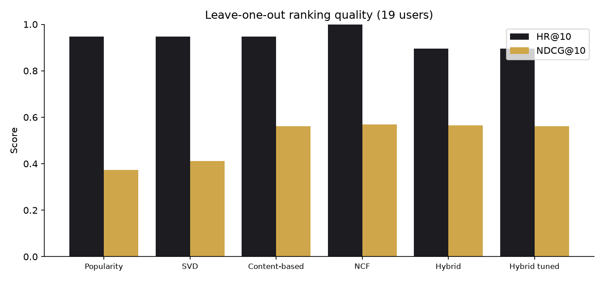
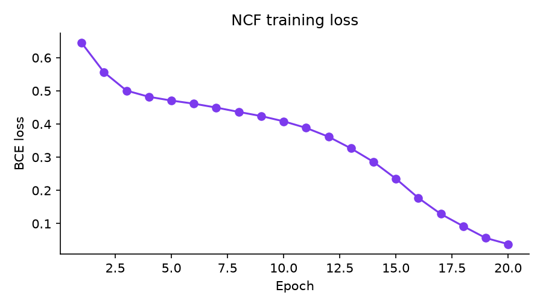

# Recommendation model comparison

Leave-one-out evaluation on `data/interactions.csv`: each user's most recent product is held out and ranked against every product they have not interacted with. Ties count against the model.

Users evaluated: **19** · average candidates per user: **7.7** · ranked products: 20 with interaction history (catalogue: 50; products without any interactions cannot be test items, so they are excluded from ranking)

| Model | HR@10 | NDCG@10 | MRR | Train time (s) |
|---|---|---|---|---|
| Popularity | 0.947 | 0.373 | 0.204 | 0.0 |
| SVD (Surprise) | 0.947 | 0.412 | 0.250 | 0.002 |
| Content-based (TF-IDF) | 0.947 | 0.561 | 0.443 | 0.017 |
| NCF (NeuMF) | 1.000 | 0.569 | 0.434 | 2.618 |
| Hybrid (0.3 SVD + 0.3 CB + 0.4 NCF) | 0.895 | 0.565 | 0.469 | 2.637 |
| Hybrid tuned (0.1 SVD + 0.6 CB + 0.3 NCF) | 0.895 | 0.562 | 0.462 | 2.637 |

Best NDCG@10: **NCF (NeuMF)**.

Hybrid weights were tuned by grid search (step 0.1) on a separate validation split (19 users, each user's most recent *training* product), never on the test items. Selected weights: SVD 0.1, content 0.6, NCF 0.3 (validation NDCG@10 0.576).

Caveats: the dataset is small (20 products, demo users and reviewers with synthetic histories), so differences between models are noisy. Re-run this script on real interaction data before drawing conclusions.
